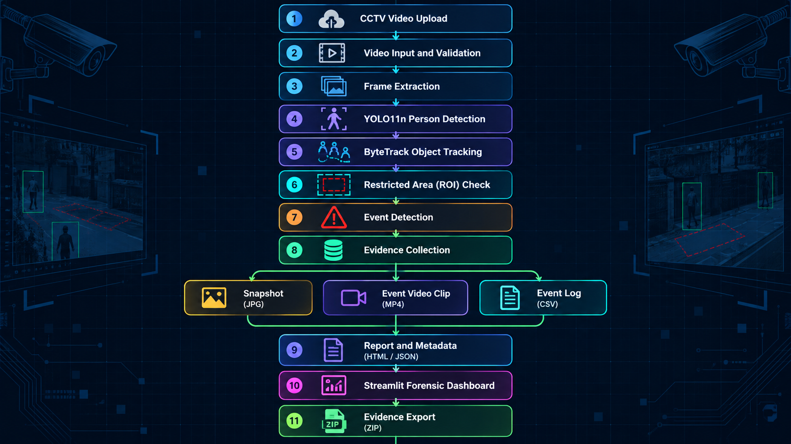

# CCTV Video Forensic Event Detection and Automated Summarisation System

An automated CCTV video analysis system that detects and tracks people entering a user-defined restricted area, captures potential forensic evidence, and generates structured event reports.

**Technologies:** Python · YOLO11n · ByteTrack · OpenCV · Streamlit

---

## Table of Contents

- [Overview](#overview)
- [Features](#features)
- [System Architecture](#system-architecture)
- [Project Structure](#project-structure)
- [Requirements](#requirements)
- [Installation](#installation)
- [Usage](#usage)
- [How It Works](#how-it-works)
- [Dashboard Modules](#dashboard-modules)
- [Configuration](#configuration)
- [Testing](#testing)
- [Output and Evidence Files](#output-and-evidence-files)
- [Limitations](#limitations)
- [Privacy and Responsible Use](#privacy-and-responsible-use)
- [License](#license)
- [Acknowledgements](#acknowledgements)

---

## Overview

Manually reviewing hours of CCTV footage to identify a specific incident can be time-consuming and error-prone. This project automates parts of the video investigation process by detecting people, tracking their movement, identifying entry events within a configured region, and collecting associated evidence.

The system provides a web-based dashboard where users can upload video footage, configure a restricted area, analyse the video, review detected events, and export reports.

The system is designed as an **investigative aid**. Automated detections indicate potential events and must be verified by a human investigator.

## Features

- **Video upload and analysis:** Analyse common video formats, including MP4, AVI, MOV, and MKV.
- **Person detection:** Use YOLO11n to detect people in video frames.
- **Multi-object tracking:** Use ByteTrack to associate detections with tracking IDs.
- **Restricted-area monitoring:** Configure a region of interest (ROI) for event detection.
- **Event detection:** Identify when a person's bottom-centre point enters the configured region.
- **Duplicate-event suppression:** Apply cooldown and exit-grace logic to reduce repeated detections.
- **Evidence snapshots:** Save images containing the detected person and ROI overlay.
- **Event video clips:** Generate short clips containing footage before and after a detected event.
- **Interactive dashboard:** Review statistics, event logs, person summaries, snapshots, and video clips.
- **Automated reporting:** Generate a standalone HTML summary and a CSV event log.
- **Evidence integrity checks:** Calculate SHA-256 hashes for the source video and event log.
- **Evidence export:** Download generated evidence and metadata in a ZIP archive.
- **CPU support:** Run analysis without requiring a dedicated GPU.

---

## System Architecture

The system follows a video-processing pipeline:



### Main Components

| Component | Responsibility |
|---|---|
| Streamlit | Provides the interactive user interface and dashboard. |
| OpenCV | Reads video frames and handles image and video processing. |
| YOLO11n | Detects people in sampled frames. |
| ByteTrack | Associates detections across frames using tracking IDs. |
| Event processing logic | Checks ROI entry and suppresses duplicate events. |
| SHA-256 | Generates hashes for basic integrity verification. |
| CSV, JSON, and HTML | Store event records, metadata, and summary reports. |

---

## Project Structure

```text
CCTV-Forensic-System/
├── .streamlit/
│   └── config.toml
├── data/
│   ├── uploads/
│   ├── events.csv
│   └── roi.txt
├── outputs/
│   ├── snapshots/
│   ├── events/
│   └── summaries/
│       ├── metadata.json
│       └── summary.html
├── src/
│   ├── app.py
│   └── process_video.py
├── yolo11n.pt
├── requirements.txt
├── .gitignore
└── README.md
```

### Directory Description

- `src/app.py` — Streamlit application and dashboard.
- `src/process_video.py` — Video processing, detection, tracking, event logic, and evidence generation.
- `yolo11n.pt` — YOLO11n model weights.
- `requirements.txt` — Python dependencies.
- `data/uploads/` — Uploaded source videos.
- `data/events.csv` — Generated event records.
- `data/roi.txt` — Optional saved ROI coordinates.
- `outputs/snapshots/` — Event snapshot images.
- `outputs/events/` — Event video clips.
- `outputs/summaries/metadata.json` — Analysis metadata and source-video hash.
- `outputs/summaries/summary.html` — Generated HTML event report.

Generated files and uploaded videos should remain excluded from version control unless there is a specific reason to publish them.

---

## Requirements

- Python 3.11 or 3.12 recommended.
- Python 3.13 may also work with compatible PyTorch packages.
- Git.
- A supported operating system: Windows, Linux, or macOS.
- Sufficient RAM and disk space for video processing and evidence storage.
- An internet connection for installing dependencies and downloading model weights, when required.

A dedicated GPU is not required, although performance depends on the processor, video resolution, and analysis settings.

---

## Installation

### 1. Clone the repository

```bash
git clone https://github.com/jadhav1919/CCTV-Forensic-System.git
cd CCTV-Forensic-System
```

### 2. Create a virtual environment

**Windows:**

```powershell
python -m venv venv
.\venv\Scripts\Activate.ps1
```

If you are using Command Prompt instead of PowerShell:

```bat
venv\Scripts\activate
```

**Linux or macOS:**

```bash
python3 -m venv venv
source venv/bin/activate
```

### 3. Install dependencies

For Python 3.13, install compatible CPU versions of PyTorch first if needed:

```bash
python -m pip install --upgrade pip
pip install torch torchvision --index-url https://download.pytorch.org/whl/cpu
```

Then install the remaining project dependencies:

```bash
pip install -r requirements.txt
```

If your Python version or operating system requires a different PyTorch installation, follow the official [PyTorch installation guide](https://pytorch.org/get-started/locally/).

The project uses `imageio-ffmpeg` for bundled FFmpeg support, so a separate FFmpeg installation may not be necessary for the configured workflow.

### 4. Verify the project files

Ensure that the following files exist:

```text
src/app.py
src/process_video.py
requirements.txt
yolo11n.pt
```

If the model weights are not included in your local copy, obtain them through the appropriate Ultralytics model download process.

---

## Usage

### 1. Start the application

From the project root, run:

```bash
streamlit run src/app.py
```

### 2. Open the dashboard

Open the local URL displayed in the terminal:

```text
http://localhost:8501
```

### 3. Upload a video

Navigate to the **Analyse a new video** section and select a supported CCTV video.

### 4. Configure the restricted area

Set the region of interest (ROI) using its X, Y, width, and height coordinates.

Review the preview to confirm that the selected rectangle covers the intended restricted area.

### 5. Start forensic analysis

Click **Start forensic analysis**.

The application processes the video and displays progress and processing logs.

## Test Videos

Download the sample videos below to test the CCTV forensic analysis system.

1. [Download Test Video 1](https://github.com/jadhav1919/CCTV-Forensic-System/raw/refs/heads/main/test_videos/1044-142621375_medium.mp4)
2. [Download Test Video 2](https://github.com/jadhav1919/CCTV-Forensic-System/raw/refs/heads/main/test_videos/22516-328624717_medium.mp4)
3. [Download Test Video 3](https://github.com/jadhav1919/CCTV-Forensic-System/raw/refs/heads/main/test_videos/33569-397143928_medium.mp4)


### How to Test

1. Download a video.
2. Open the application using `streamlit run src/app.py`.
3. Upload the video and configure the restricted area (ROI).
4. Start analysis and review the detected events, snapshots, clips, and reports.


### 6. Review the results

After processing, inspect the dashboard to review detected events, person tracking summaries, snapshots, video clips, and generated reports.

### 7. Export the evidence

Use the available download controls in the Reports & Export section to obtain the generated files.

**Tip:** For an initial test, use a short video of approximately 10–30 seconds containing visible people moving through the scene.

---

## How It Works

### 1. Video Processing

The system reads the uploaded video and samples frames for analysis. The configured target sampling rate is approximately five frames per second.

This reduces the number of frames requiring inference compared with processing every frame of a high-frame-rate video.

### 2. Person Detection

YOLO11n detects people in sampled frames. The configured inference size is 480 × 480 pixels.

Detection quality depends on image resolution, lighting, camera angle, distance, and obstruction.

### 3. Object Tracking

ByteTrack associates person detections across frames and assigns tracking IDs.

Additional re-association logic can treat a briefly lost track and a nearby new track as the same person when the configured conditions are satisfied. This is a heuristic and does not guarantee identity continuity.

### 4. Restricted-Area Event Detection

The system checks the bottom-centre point of a person's bounding box against the configured ROI.

When the point enters the restricted area, the system can record an event and collect associated evidence.

### 5. Duplicate-Event Suppression

The event logic uses configurable timing rules to reduce repeated triggers:

- **Cooldown:** A minimum interval between events associated with the same person.
- **Exit grace:** A person must remain outside the ROI for a configured period before another entry can count as a new event.
- **Track re-association:** Brief tracking interruptions may be handled using spatial and temporal conditions.

These mechanisms reduce some duplicate detections but do not eliminate all false positives or missed events.

### 6. Evidence Collection

For each detected event, the system can generate:

- A snapshot with the ROI and person bounding box.
- A short video clip containing approximately five seconds before and five seconds after the event, subject to available footage.
- A structured event record containing relevant event information.

### 7. Report Generation

The system creates a CSV event log, JSON metadata, and an HTML summary.

SHA-256 hashes are calculated for the source video and event log to support basic integrity checks.

A matching hash can help establish that a file has not changed relative to a previously recorded hash. It does not independently prove authenticity, establish a complete chain of custody, or prevent later tampering.

---

## Dashboard Modules

| Module | Description |
|---|---|
| **Overview** | Displays key performance indicators, event activity, and key findings. |
| **Event log** | Shows recorded events and the availability of associated evidence. |
| **Person analysis** | Presents per-tracking-ID summaries, event counts, and timeline information. |
| **Evidence gallery** | Displays generated event snapshots. |
| **Event clips** | Provides playback of generated event video clips. |
| **Reports & export** | Provides integrity hashes and available report and evidence downloads. |

The person-analysis output is based on anonymous tracking IDs and configured heuristics. It should not be interpreted as verified identity or proof of suspicious behaviour.

---

## Configuration

The following settings are described in the current project configuration. Confirm their exact names and locations in `src/process_video.py` before modifying them.

### Detection Performance

```python
TARGET_FPS = 5.0
INFERENCE_SIZE = 480
```

- Increase `TARGET_FPS` to analyse more frames per second, potentially improving the handling of fast movement at the cost of processing time.
- Increase `INFERENCE_SIZE` to 640 if more image detail is needed and the available hardware can handle the additional workload.
- Reduce these values on slower machines when processing speed is a priority.

### Event Sensitivity

```python
COOLDOWN_SECONDS = 5.0
EXIT_GRACE_SECONDS = 1.5
REASSOC_DISTANCE = 150
REASSOC_TIME = 2.0
```

- Increase the cooldown to reduce repeated events for the same tracking ID.
- Adjust the exit-grace period to control when a subsequent entry can count as a new event.
- Adjust re-association distance and time carefully to balance track continuity against incorrect associations.

These settings affect the event-detection behaviour and should be validated using representative test footage.

---

## Testing

The project test plan covers six main areas.

| Test Case | Objective |
|---|---|
| 1. Upload & Analyse | Verify video selection, ROI preview, analysis progress, and completion. |
| 2. Overview | Verify KPI cards, event activity chart, and key findings. |
| 3. Event Log | Verify event records, evidence availability, search, and CSV export. |
| 4. Person Analysis | Verify per-person summaries, risk heuristics, and timeline information. |
| 5. Evidence Gallery & Event Clips | Verify that snapshots render and generated clips play. |
| 6. Reports & Export | Verify hashes, HTML and CSV reports, and evidence ZIP downloads. |

### Suggested Test Procedure

1. Start the Streamlit application.
2. Upload a short test video.
3. Configure the ROI and confirm its position.
4. Run the analysis.
5. Check that detected events appear in the event log.
6. Open the evidence gallery and play available event clips.
7. Download the available reports and evidence archive.
8. Compare the generated outputs against the expected behaviour.

Record the test video, application version, expected result, actual result, and any errors for reproducibility.

---

## Output and Evidence Files

| File or Directory | Purpose |
|---|---|
| `data/events.csv` | Structured event records. |
| `outputs/snapshots/` | Generated JPG evidence snapshots. |
| `outputs/events/` | Generated MP4 event clips. |
| `outputs/summaries/metadata.json` | Analysis metadata, ROI details, processing information, and hashes. |
| `outputs/summaries/summary.html` | Standalone HTML summary with embedded snapshots. |
| Evidence ZIP archive | Downloadable collection of supported evidence files and metadata. |

Actual output availability depends on the processing result and the files generated by the application.

### Evidence Handling Recommendations

- Preserve the original source video.
- Record the SHA-256 hash before and after transferring evidence.
- Keep generated evidence separate from original footage.
- Document the time, system configuration, and processing settings used during analysis.
- Restrict access to CCTV footage and generated evidence.
- Verify detections manually before using them in an investigation.

---

## Limitations

- **No face recognition:** The system uses anonymous tracking IDs and does not identify people by name.
- **Single-camera processing:** Cross-camera tracking is not implemented.
- **Detection errors:** Lighting, low resolution, occlusion, camera angle, and crowded scenes can affect results.
- **Sampling limitations:** Analysing sampled frames can miss short events occurring between sampled frames.
- **Tracking limitations:** A tracking ID does not guarantee that the same physical person is associated with that ID throughout the video.
- **ROI limitations:** Entry detection depends on the configured region and the bottom-centre point of the person's bounding box.
- **Integrity limitations:** SHA-256 hashes provide basic file-integrity checks, not a complete forensic chain-of-custody solution.
- **Performance variability:** Processing speed depends on hardware, video properties, model settings, and scene complexity.
- **Investigative limitations:** Automated detections are leads for review, not proof of wrongdoing.

---

## Privacy and Responsible Use

Use this project only with CCTV footage you are authorised to process.

- Obtain the necessary permissions before analysing recorded footage.
- Follow applicable privacy, data-protection, and surveillance laws.
- Store videos and generated evidence securely.
- Avoid publishing identifiable footage, snapshots, or sensitive metadata in a public repository.
- Use human review to validate automated detections before drawing conclusions.

This project is intended for academic, research, and authorised forensic-analysis purposes.

---

## License

This project was developed as an academic project. No formal open-source license is specified here.

If you intend to distribute or permit reuse of the source code, add an appropriate license file and confirm that the model weights and third-party dependencies permit the intended use.

---

## Acknowledgements

- [Ultralytics](https://github.com/ultralytics/ultralytics) — YOLO models and tracking integration.
- [Streamlit](https://streamlit.io/) — Interactive web application framework.
- [OpenCV](https://opencv.org/) — Computer vision and video processing.
- [PyTorch](https://pytorch.org/) — Deep learning framework.
- [imageio-ffmpeg](https://github.com/imageio/imageio-ffmpeg) — FFmpeg binary support.

---

**Repository:** [CCTV-Forensic-System](https://github.com/jadhav1919/CCTV-Forensic-System)

